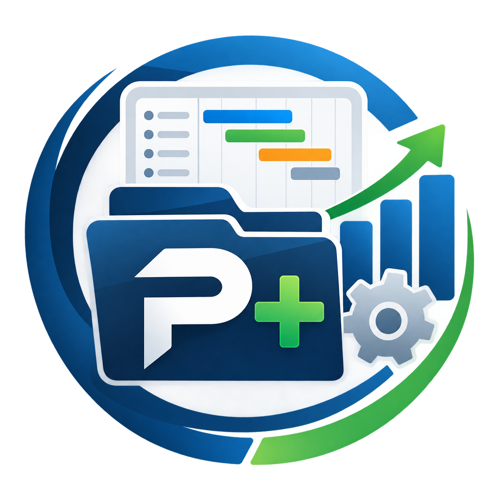

# Project+ — Portfólio de Projetos

  

Plugin para GLPI 10 que organiza a solicitação, avaliação, priorização,
autorização e abertura de projetos a partir de chamados. O Project+ preserva o
chamado como registro da demanda e cria o projeto nativo do GLPI somente depois
da conclusão sequencial das etapas exigidas.

> ### ⚠️ Compatibilidade: somente GLPI 10.0.x
>
> Esta linha funciona exclusivamente em **GLPI 10.0.20 a 10.0.99**, com
> **PHP 7.4 ou superior**. Não instale em GLPI 11.

## Funcionalidades

**Fluxo de solicitação de projeto**

- Etapas sequenciais: TIP, TIP - Detalhamento Técnico, priorizações técnica e
  estratégica, autorização de abertura, TAP e criação do projeto.
- Nenhuma etapa posterior pode ser executada antes da conclusão da anterior.
- Textos de orientação, pendência, encaminhamento e consequência configuráveis
  por etapa.
- Recusa do TIP devolve a solicitação ao requerente para ajuste, mantendo as
  respostas e os anexos já enviados.
- Autorização de abertura pelo Gestor de Portfólio, com registro de justificativa
  e possibilidade de negar a abertura pela solução nativa do GLPI.

**Documentos e termos**

- Modelos independentes de TIP, TIP - DT, TAP, TEP e TA, com campos
  configuráveis por entidade, obrigatoriedade, ordem e disponibilidade para
  entidades filhas.
- Preenchimento a partir de fontes explícitas — chamado e documentos anteriores
  — sem sobrescrever campos definidos como preenchimento manual.
- Geração, envio, aceite, recusa, histórico e PDF dos documentos com controle
  de acesso ao item de origem.

**Roteamento, priorização e projeto**

- Roteamento por entidade, categoria ITIL, Gerente de Projetos e Gestor de
  Portfólio, com busca hierárquica do responsável mais próximo.
- Perfis granulares para documentos, priorizações, fluxo, projetos e interações.
- Ranking institucional e filtros na pesquisa nativa de chamados e projetos.
- Abertura de projeto nativo vinculada ao chamado, com caixa de solução nativa,
  modelos, anexos e tipo de solução.
- Configuração da origem dos campos nativos do projeto e bloqueio de conclusão
  de projetos do fluxo até o aceite do TA.

**Acompanhamento e portal**

- Interações, tarefas, soluções, documentos, validações e transferência de
  projetos entre entidades autorizadas.
- Notificações nativas para interações de projeto, configuráveis pelo GLPI.
- Portal de consulta para solicitantes e pontos focais, com projetos vinculados,
  termos e interações permitidas.

## Como funciona

O fluxo respeita o perfil ativo, a visibilidade do chamado e o acesso efetivo à
entidade. Configurações recursivas nunca substituem a autorização ao objeto
específico.

## Demonstração

Em uma solicitação de projeto habilitada, o solicitante preenche o TIP; o
Gerente de Projetos analisa e libera o Detalhamento Técnico; as priorizações e
a autorização de abertura são concluídas; por fim, o TAP é aceito antes de o
Project+ criar o projeto nativo vinculado e solucionar o chamado.

## Compatibilidade

- GLPI: **10.0.20 a 10.0.99**.
- PHP: **7.4 ou superior**.
- Banco de dados: MySQL ou MariaDB compatíveis com o GLPI 10.

## Instalação

1. Copie a pasta `projectplus` para `GLPI_ROOT/plugins/`.
2. Em **Configurar > Plugins**, instale e ative **Project+**.
3. Em **Administração > Perfis**, conceda os direitos do Project+ aos perfis
   que atuarão no fluxo.
4. Em **Configurar > Project+**, habilite as categorias ITIL, configure os
   responsáveis, os modelos documentais e as regras aplicáveis às entidades.

Para atualizar, faça backup da pasta do plugin e use a pasta completa da versão
nova. Não use cópia parcial por sobrescrita: arquivos removidos em versões novas
podem permanecer na instalação anterior.

## Permissões

As permissões ficam em **Administração > Perfis > Project+** e são separadas em
Documentos, Priorização, Fluxo, Projetos, Interações e Configurar. A posse de
uma permissão não dispensa o acesso ao chamado, projeto ou entidade envolvidos.

## Versão e histórico

- Versão atual: **0.9.14**.
- Tag desta versão: **v0.9.14**.
- Histórico completo: [CHANGELOG.md](CHANGELOG.md).

## Documentação

- [Histórico de alterações](CHANGELOG.md)
- [Roadmap técnico e de melhorias](../../../docs/projectplus/ROADMAP_MELHORIAS_TECNICAS_CSS_E_RELEASE.md)
- [Validações do plugin](../../../docs/projectplus/validacoes/)

## Suporte e contato

- Dúvidas, problemas e sugestões: [GitLab Issues](https://git.unifesp.br/dssc/sua-unifesp/glpi/plugins/project-plus/-/issues)
- Autor: Fabio Neres
- Equipe responsável: SUA UNIFESP
- Licença: [GPLv3+](https://www.gnu.org/licenses/gpl-3.0.html)
